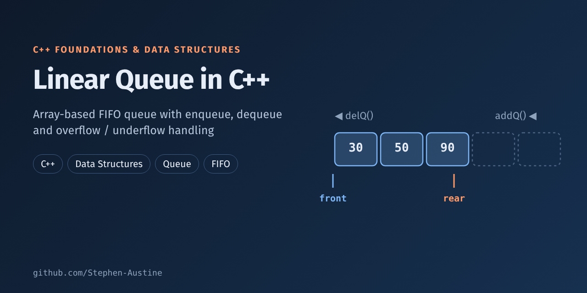
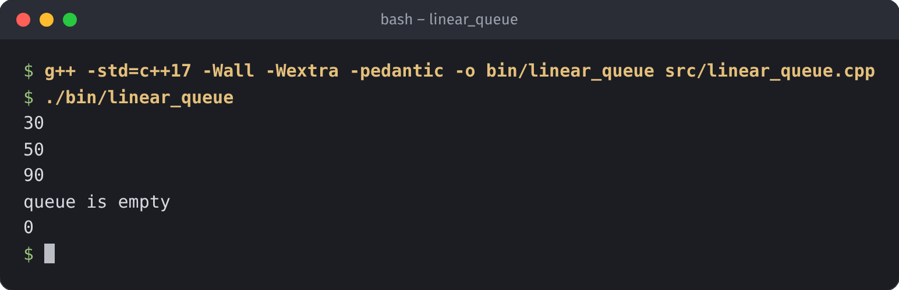
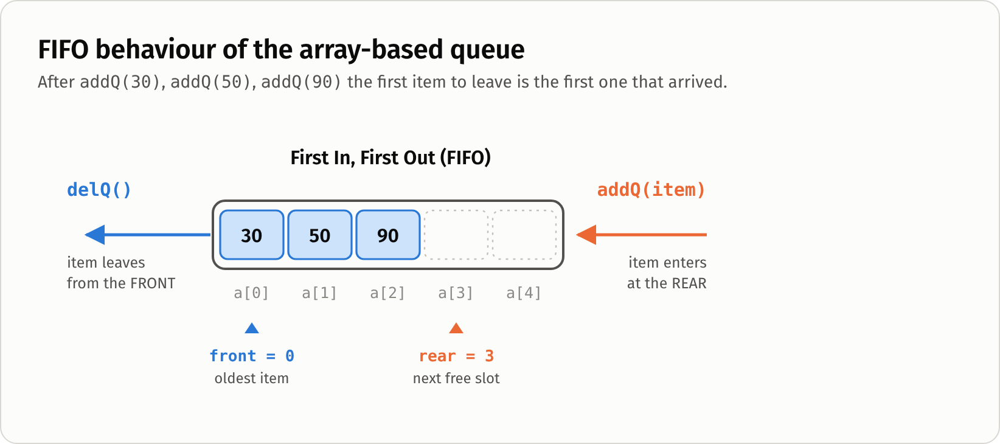
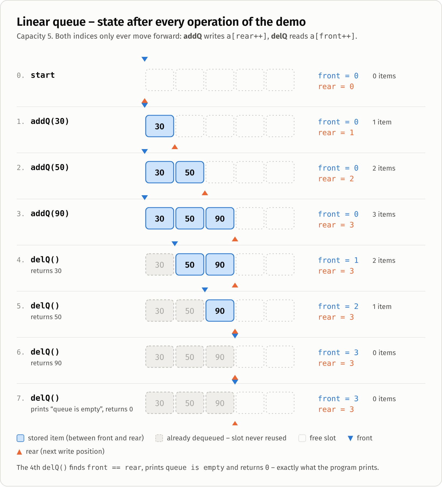
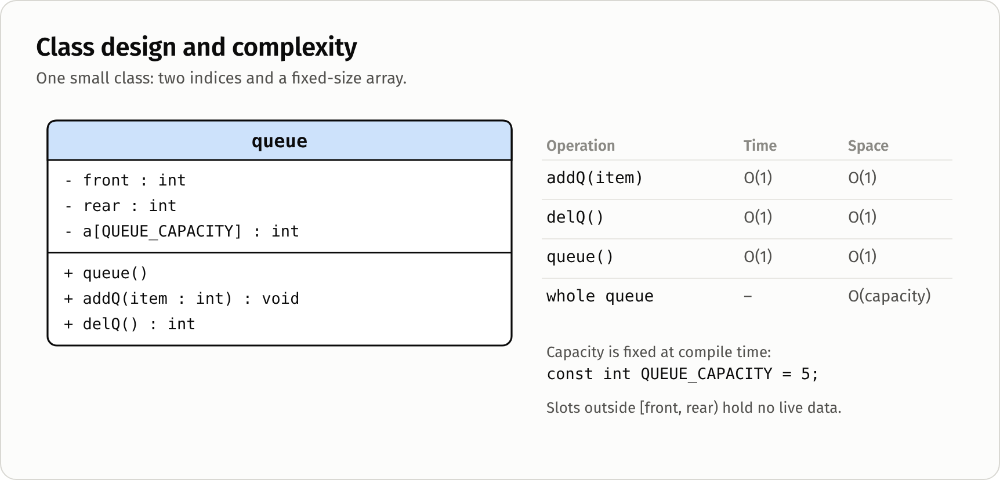
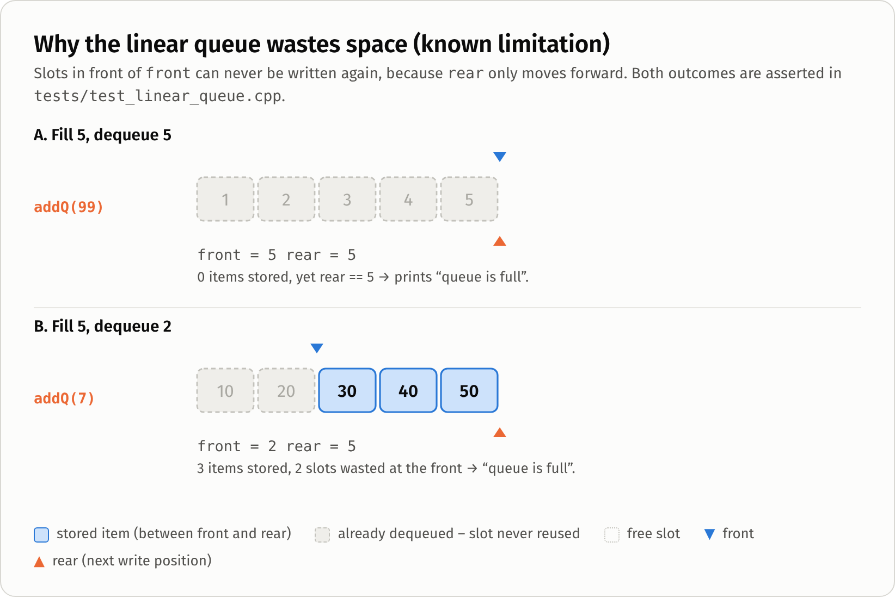

<div align="center">



# C++ Linear Queue – Array-Based Implementation with Enqueue and Dequeue

**A small, readable C++ implementation of the classic array-based linear queue (FIFO) – with overflow and underflow handling, a verified demo, unit tests, and an honest look at why the linear design wastes space.**

[](https://github.com/Stephen-Austine/CPP-Linear-Queue-Array-Based-Implementation-with-Enqueue-and-Dequeue/actions/workflows/ci.yml)


</div>

---

## Table of contents

1. [Overview](#1-overview)
2. [What you will learn](#2-what-you-will-learn)
3. [Demo](#3-demo)
4. [How a linear queue works](#4-how-a-linear-queue-works)
5. [Project structure](#5-project-structure)
6. [Getting started](#6-getting-started)
7. [The source code, explained](#7-the-source-code-explained)
8. [Step-by-step trace of the demo](#8-step-by-step-trace-of-the-demo)
9. [Complexity analysis](#9-complexity-analysis)
10. [Testing](#10-testing)
11. [Known limitations](#11-known-limitations)
12. [Ideas for improving the design](#12-ideas-for-improving-the-design)
13. [Changes made when preparing this repository](#13-changes-made-when-preparing-this-repository)
14. [Practice exercises](#14-practice-exercises)
15. [FAQ](#15-faq)
16. [Related projects](#16-related-projects)
17. [License and author](#17-license-and-author)

---

## 1. Overview

A **queue** is a collection that works like a line at a ticket counter: the first person to join is the first person served. Computer scientists call this **FIFO – First In, First Out**.

This project implements that idea in the most fundamental way possible: a fixed-size C++ `int` array and two integer indices.

| Piece | Role |
|---|---|
| `int a[QUEUE_CAPACITY]` | Storage for up to **5** integers |
| `front` | Index of the oldest item (the next one to leave) |
| `rear` | Index of the next free slot (where the next item will be written) |
| `addQ(item)` | **Enqueue** – writes `item` at `rear`, then moves `rear` forward |
| `delQ()` | **Dequeue** – reads the item at `front`, then moves `front` forward |

The program is intentionally tiny, so every line can be understood. It is also the *"before"* picture for its sibling project, the [circular queue](https://github.com/Stephen-Austine/CPP-Circular-Queue-Array-Based-Implementation-with-Wraparound-Indexing), which fixes the main weakness described in [section 11](#11-known-limitations).

### Highlights

- Pure standard C++ – only `<iostream>`; no external libraries.
- Handles both error conditions: **overflow** (`queue is full`) and **underflow** (`queue is empty`).
- Builds warning-free with `-Wall -Wextra -pedantic` on **C++11, 14, 17 and 20**, with both **g++** and **clang++**.
- Ships with a unit-test suite (9 checks), a `Makefile`, and a GitHub Actions workflow.
- Documents its own limitations with *tests that prove them*, rather than hiding them.

---

## 2. What you will learn

- What an abstract data type (ADT) is, and how a **class** implements one.
- How `front` and `rear` indices model a queue on top of a plain array.
- The difference between **overflow** and **underflow**, and how each is detected.
- Why `a[rear++] = item` is a compact "write, then advance" idiom.
- Why a **linear** array-backed queue wastes memory – and the motivation for the circular queue.
- How to unit-test a program whose output goes to `std::cout` (by redirecting the stream buffer).
- How constants, `const`, and name lookup (`using namespace std`) can cause a real compile error.

---

## 3. Demo

The program enqueues `30`, `50`, `90`, then dequeues four times. The fourth dequeue hits an empty queue.

<p align="center">
  
</p>

> The screenshot is a real capture of the compiled program running in a terminal, not a mock-up.

Output, exactly as printed:

```text
30
50
90
queue is empty
0
```

The final `0` is the value `delQ()` returns when the queue is empty – a **sentinel** that says "nothing to give you". (See [limitation 2](#11-known-limitations) for why that is slightly dangerous.)

---

## 4. How a linear queue works

### 4.1 The FIFO idea

<p align="center">
  
</p>

- New items are added at the **rear** (the right-hand end).
- Items are removed from the **front** (the left-hand end).
- Therefore items leave in exactly the order in which they arrived.

### 4.2 The two indices

| State | `front` | `rear` | Meaning |
|---|---|---|---|
| Brand-new queue | `0` | `0` | Empty: `front == rear` |
| After `addQ(30)` | `0` | `1` | One item, stored in `a[0]` |
| After one `delQ()` | `1` | `1` | Empty again: `front == rear` |
| `rear == QUEUE_CAPACITY` | any | `5` | **Full** (as far as the code is concerned) |

The two conditions that guard every operation are therefore:

```text
empty  ⇔  front == rear
full   ⇔  rear  == QUEUE_CAPACITY
```

The number of items currently stored is simply `rear - front`.

### 4.3 Enqueue (`addQ`)

```text
if rear == QUEUE_CAPACITY      → print "queue is full"   (item is dropped)
else                           → a[rear] = item; rear = rear + 1
```

### 4.4 Dequeue (`delQ`)

```text
if front == rear               → print "queue is empty"; return 0
else                           → item = a[front]; front = front + 1; return item
```

> **Note that nothing is ever erased.** Dequeuing only moves `front` forward; the old value stays in memory until it is overwritten (which, in a linear queue, never happens – see below).

---

## 5. Project structure

```text
CPP-Linear-Queue-Array-Based-Implementation-with-Enqueue-and-Dequeue/
├── src/
│   └── linear_queue.cpp          # the queue class + a small demo main()
├── tests/
│   └── test_linear_queue.cpp     # unit tests (9 checks) – includes the source directly
├── docs/
│   └── images/                   # every figure used in this README
├── .github/
│   └── workflows/ci.yml          # builds + tests on C++11/14/17/20
├── Makefile                      # make | make run | make test | make clean
├── .gitignore
├── LICENSE                       # MIT
└── README.md
```

---

## 6. Getting started

### 6.1 Prerequisites

Any C++11-or-newer compiler:

| Platform | How to get one |
|---|---|
| Linux (Debian/Ubuntu) | `sudo apt install build-essential` |
| macOS | `xcode-select --install` (provides `clang++`) |
| Windows | [MSYS2 / MinGW-w64](https://www.msys2.org/) for `g++`, or Visual Studio's C++ workload |

`make` is optional – a one-line `g++` command works too.

### 6.2 Clone

```bash
git clone https://github.com/Stephen-Austine/CPP-Linear-Queue-Array-Based-Implementation-with-Enqueue-and-Dequeue.git
cd CPP-Linear-Queue-Array-Based-Implementation-with-Enqueue-and-Dequeue
```

### 6.3 Build and run with `make`

```bash
make          # compiles src/linear_queue.cpp  ->  bin/linear_queue
make run      # builds (if needed) and runs the demo
make test     # builds and runs the unit tests
make clean    # removes bin/
```

Use a different compiler or standard without editing anything:

```bash
make CXX=clang++
make CXXFLAGS="-std=c++11 -Wall -Wextra -pedantic -O2"
```

### 6.4 Build and run without `make`

```bash
mkdir -p bin
g++ -std=c++17 -Wall -Wextra -pedantic -o bin/linear_queue src/linear_queue.cpp
./bin/linear_queue
```

On Windows (MinGW) the executable is `bin\linear_queue.exe`. With the Visual Studio developer prompt, the equivalent command is `cl /EHsc /std:c++17 src\linear_queue.cpp` (the MSVC route has not been tested for this repository; the g++ and clang++ routes have).

---

## 7. The source code, explained

Full file: [`src/linear_queue.cpp`](src/linear_queue.cpp)

```cpp
#include <iostream>
using namespace std;

const int QUEUE_CAPACITY = 5;

class queue
{
	int front , rear;
	int a[QUEUE_CAPACITY];
	public:
	queue(){front=0;rear=0;} /*Constructor to create an empty queue*/
	void addQ(int item)/* enqueue operation*/
	{
		if(rear==QUEUE_CAPACITY)
			cout<<"queue is full"<<endl;
 		else
			a[rear++]=item;
	}
	int delQ() /* dequeue operation*/
	{
		if(front==rear)
			{
				cout<<"queue is empty"<<endl;
				return 0;
			}
		else
			return a[front++];
	}
};
```

### 7.1 Line-by-line

| Code | Explanation |
|---|---|
| `const int QUEUE_CAPACITY = 5;` | Maximum number of items. It must be a compile-time constant because it sizes the array. |
| `class queue` | Bundles the data (`front`, `rear`, `a`) and the operations (`addQ`, `delQ`). Members are **private by default**, so outside code cannot corrupt the indices. |
| `int front, rear;` | The two indices described in [section 4](#4-how-a-linear-queue-works). |
| `int a[QUEUE_CAPACITY];` | The storage. Slots are *not* zero-initialised – only slots between `front` and `rear` hold meaningful data. |
| `queue(){front=0;rear=0;}` | Constructor: starts every new queue in the empty state. |
| `if(rear==QUEUE_CAPACITY)` | Overflow test. When `rear` has reached 5, there is no slot left to write to. |
| `a[rear++]=item;` | **Post-increment**: write `item` into `a[rear]`, *then* add one to `rear`. Equivalent to two statements: `a[rear]=item; rear=rear+1;`. |
| `if(front==rear)` | Underflow test. Nothing between `front` and `rear` means nothing to read. |
| `return a[front++];` | Return the oldest item, then advance `front`. |
| `return 0;` after the message | A sentinel value, so the function still returns *something*. |

### 7.2 The demo `main()`

```cpp
int main()
{
	/*enqueue operation*/
	queue q1;
	q1.addQ(30);
	q1.addQ(50);
	q1.addQ(90);

	/*dequeue operations*/
	cout<<q1.delQ()<<endl;   // 30
	cout<<q1.delQ()<<endl;   // 50
	cout<<q1.delQ()<<endl;   // 90
	cout<<q1.delQ()<<endl;   // prints "queue is empty", then 0

	return 0;
}
```

The fourth line deserves a closer look. `cout << q1.delQ() << endl;` first *calls* `delQ()`. Inside the call the message `queue is empty` is printed. Only afterwards is the returned `0` sent to `cout`. That is why the message appears on the line **before** the `0`.

---

## 8. Step-by-step trace of the demo

Every state of the queue after each operation of the demo. The diagram is generated from a model of the C++ logic that was checked against the program's real output (30, 50, 90, then empty).

<p align="center">
  
</p>

How to read it:

- **Blue cells** lie between `front` and `rear` – they are the items currently in the queue.
- **Grey dashed cells** are slots that were dequeued. They still contain the old number, but the queue will never use them again.
- **Dotted empty cells** have never been written.
- **▼ front** and **▲ rear** sit on the *left edge* of the slot they point at, so `rear = 5` appears at the right-hand end of the array.

Text version of the same trace:

| # | Operation | `a[0..4]` (· = unused) | `front` | `rear` | Items | Result |
|---|---|---|---|---|---|---|
| 0 | *(start)* | `· · · · ·` | 0 | 0 | 0 | |
| 1 | `addQ(30)` | `30 · · · ·` | 0 | 1 | 1 | |
| 2 | `addQ(50)` | `30 50 · · ·` | 0 | 2 | 2 | |
| 3 | `addQ(90)` | `30 50 90 · ·` | 0 | 3 | 3 | |
| 4 | `delQ()` | `30 50 90 · ·` | 1 | 3 | 2 | returns **30** |
| 5 | `delQ()` | `30 50 90 · ·` | 2 | 3 | 1 | returns **50** |
| 6 | `delQ()` | `30 50 90 · ·` | 3 | 3 | 0 | returns **90** |
| 7 | `delQ()` | `30 50 90 · ·` | 3 | 3 | 0 | prints `queue is empty`, returns **0** |

---

## 9. Complexity analysis

<p align="center">
  
</p>

| Operation | Time | Extra space | Why |
|---|---|---|---|
| `queue()` | O(1) | O(1) | Two assignments |
| `addQ(item)` | **O(1)** | O(1) | One comparison, one array write, one increment |
| `delQ()` | **O(1)** | O(1) | One comparison, one array read, one increment |
| Whole queue | – | **O(QUEUE_CAPACITY)** | One fixed array of 5 `int`s |

Both core operations are **constant time** – nothing is shifted or copied. That is the main advantage of the two-index design over a naive "remove element 0 and shift everything left" approach, which would make dequeue O(n).

---

## 10. Testing

### 10.1 Running the tests

```bash
make test
```

Expected output:

```text
linear_queue tests
  PASS  demo output: 30 50 90, then 'queue is empty' and 0
  PASS  items leave in the order they entered (FIFO)
  PASS  dequeue from empty queue -> message and 0
  PASS  6th enqueue prints 'queue is full'
  PASS  the five accepted items are intact; the rejected one is dropped
  PASS  queue is empty after draining five items
  PASS  KNOWN LIMITATION: empty-but-exhausted queue still reports 'queue is full'
  PASS  KNOWN LIMITATION: freed front slots are not reused
  PASS  KNOWN LIMITATION: a stored 0 and the empty-queue sentinel 0 look identical to the caller
9/9 checks passed
```

### 10.2 How the tests work

The program prints to `std::cout`, so the test file captures that stream instead of reading it from a terminal:

```cpp
#define main demo_main                 // rename the program's own main()
#include "../src/linear_queue.cpp"     // pull the whole program into the test
#undef main
```

A small helper swaps `std::cout`'s buffer for a string buffer while a lambda runs, then restores it. This lets the test assert on the exact text the queue prints (for example `"queue is full\n"`).

### 10.3 What is covered

| Test | Verifies |
|---|---|
| Demo output | The program prints `30 50 90`, `queue is empty`, `0` |
| FIFO order | `1, 2, 3` in → `1, 2, 3` out |
| Underflow | Dequeue on a new queue prints the message and returns `0` |
| Overflow | The 6th `addQ` prints `queue is full`; the first five items are intact |
| Drain | After removing five items the queue reports empty |
| Exhausted queue | After fill-5/drain-5, `addQ` still says *full* (limitation 1) |
| Partial drain | After fill-5/drain-2, `addQ` still says *full* (limitation 1) |
| Stored zero | A real `0` is indistinguishable from the "empty" result (limitation 2) |

The last three are deliberately **tests of the limitations**: they pass today because the limitations exist. If you fix a limitation, those tests will (correctly) start failing and need to be updated.

### 10.4 Continuous integration

`.github/workflows/ci.yml` runs `make test` on every push and pull request, once per language standard (C++11, 14, 17 and 20), using `-Wall -Wextra -pedantic`.

---

## 11. Known limitations

These are properties of the *original design*, preserved here so the project can be used to teach them. Each one is demonstrated by a test.

### 1. Space is never reused (the big one)

`front` and `rear` only move **forward**. Once `rear` reaches 5, `addQ` refuses new items – even if every earlier item has been dequeued.

<p align="center">
  
</p>

| Scenario | Items stored | `addQ(x)` result |
|---|---|---|
| Add 5, remove 5 | **0** | `queue is full` |
| Add 5, remove 2 | **3** | `queue is full` |

In effect the queue can handle only **5 enqueues in total over its entire lifetime**, not 5 items at a time. The [circular queue](https://github.com/Stephen-Austine/CPP-Circular-Queue-Array-Based-Implementation-with-Wraparound-Indexing) removes this restriction by wrapping the indices around the array.

### 2. The `0` sentinel is ambiguous

`delQ()` returns `0` on underflow – but `0` is also a perfectly valid item. A caller cannot tell "the queue held a zero" from "the queue was empty" without reading the console message.

### 3. Items are dropped silently (to the caller)

On overflow `addQ` prints a message and returns `void`. The *caller's* code gets no signal that the item was lost.

### 4. Fixed capacity

`QUEUE_CAPACITY` is fixed at compile time. There is no resizing.

### 5. Minimal interface

There is no `size()`, `isEmpty()`, `isFull()`, `peek()` or `clear()`.

### 6. Input/output is mixed into the logic

The class itself prints messages, which makes it awkward to reuse in a GUI or library (the unit tests have to capture `cout` to check behaviour).

### 7. The class name `queue` can clash with `std::queue`

Because of `using namespace std;`, adding `#include <queue>` to this file turns every use of `queue` into an error:

```text
error: reference to 'queue' is ambiguous
```

(This was confirmed by compiling a copy of the file with that include added.) Renaming the class – for example to `LinearQueue` – avoids the problem.

### 8. Works only for `int`

No templates, so a queue of `double` or `std::string` needs a copy of the class.

---

## 12. Ideas for improving the design

> These snippets are **suggestions**, not part of the repository's source. They were each compiled and run with `g++ -std=c++17 -Wall -Wextra -pedantic` before being included here.

### 12.1 Return values instead of printing, and no magic zero

```cpp
#include <iostream>
#include <optional>
#include <string>

class LinearQueue {
    static constexpr int CAPACITY = 5;
    int front = 0, rear = 0;
    int a[CAPACITY];
public:
    bool enqueue(int item) {                 // false instead of printing
        if (rear == CAPACITY) return false;
        a[rear++] = item;
        return true;
    }
    std::optional<int> dequeue() {           // nullopt instead of a magic 0
        if (front == rear) return std::nullopt;
        int v = a[front++];
        if (front == rear) front = rear = 0; // queue drained: start over
        return v;
    }
    bool empty() const { return front == rear; }
    int  size()  const { return rear - front; }
};
```

What this fixes:

- **Limitation 2** – `dequeue()` returns `std::optional<int>`, so a real `0` (`got 0`) and "empty" (`nullopt`) are different things.
- **Limitation 3** – `enqueue()` returns `false` when the item is rejected.
- **Limitation 5** – adds `empty()` and `size()`.
- **Part of limitation 1** – resetting `front` and `rear` to `0` when the queue drains fixes *"add 5, remove 5"*. It does **not** fix *"add 5, remove 2"*; for that you need the circular design.

### 12.2 Use the standard library in real projects

```cpp
#include <iostream>
#include <queue>

int main() {
    std::queue<int> q;
    q.push(30); q.push(50); q.push(90);
    while (!q.empty()) { std::cout << q.front() << '\n'; q.pop(); }   // 30 50 90
}
```

`std::queue` (backed by `std::deque`) grows as needed, is generic over the element type, and has no wasted-space problem. Writing your own queue, as this project does, is for *learning how it works*.

---

## 13. Changes made when preparing this repository

The code in `src/linear_queue.cpp` is the original logic. Only the following changes were made:

| Change | Reason |
|---|---|
| Constant `size` renamed to `QUEUE_CAPACITY` | The original `const int size = 5;` combined with `using namespace std;` is **ambiguous with `std::size`** (added in C++17) and fails to compile on a default modern `g++`: *"reference to 'size' is ambiguous"*. The new name is also more descriptive. |
| Duplicate `using namespace std;` removed | The original declared it twice; once is enough. |
| `return 0;` added at the end of `main()` | Optional for `main` itself, but required once the test harness renames `main` to `demo_main()`. Also consistent with the other projects. |
| Descriptive header comment added | Documents purpose, behaviour and build command. |
| File renamed `queue.cpp` → `src/linear_queue.cpp` | Clearer name; conventional `src/` layout. |
| Repository files added | `README.md`, `Makefile`, `tests/`, `docs/`, CI workflow, `LICENSE`, `.gitignore`. |

Program behaviour and output are unchanged.

---

## 14. Practice exercises

1. **Print the queue.** Add a `display()` method that prints the items from `front` to `rear - 1`.
2. **Add `size()`, `isEmpty()` and `isFull()`.** Use them inside `addQ` and `delQ`.
3. **Reset on drain.** Make `delQ()` set `front = rear = 0` when the last item is removed. Which of the two scenarios in [limitation 1](#1-space-is-never-reused-the-big-one) does this fix, and which does it not?
4. **Return status.** Change `addQ` to return `bool`. Update the tests accordingly.
5. **Make it generic.** Turn the class into `template <typename T, int N>`.
6. **Shifting queue.** Implement `delQ()` so it shifts all items left by one. Compare the time complexity with the index version.
7. **Interactive menu.** Wrap the queue in a menu loop: *1 = enqueue, 2 = dequeue, 3 = display, 4 = quit*.
8. **Compare with the circular queue.** Run the same operation sequence on both projects and list where they differ.

---

## 15. FAQ

**Why does `delQ()` not erase the value?**
It does not need to. Anything outside `[front, rear)` is simply ignored. Erasing would cost extra work for no benefit.

**Why is the capacity only 5?**
It keeps traces small enough to read and makes overflow easy to trigger. Change `QUEUE_CAPACITY` to any positive integer; the tests use the constant, so they adapt automatically.

**Is this a "real" queue?**
It is a correct FIFO queue within its limits. Its flaw is the wasted space, which makes it unsuitable for long-running use.

**What happens if I enqueue a negative number?**
Nothing special – any `int` can be stored.

**Why does the output show `0` after `queue is empty`?**
Because `delQ()` returns `0` as its sentinel and `main()` prints whatever `delQ()` returns. See [section 7.2](#72-the-demo-main).

**Will it compile with C++98?**
The code itself uses no newer features, but the Makefile and tests target C++11 and up.

---

## 16. Related projects

This repository is one of five small C++ foundations projects:

| Project | Topic |
|---|---|
| **This repo** – Linear Queue | Array-based FIFO, overflow/underflow |
| [Circular Queue](https://github.com/Stephen-Austine/CPP-Circular-Queue-Array-Based-Implementation-with-Wraparound-Indexing) | Wrap-around indexing, counter for full/empty |
| [Binary Search](https://github.com/Stephen-Austine/CPP-Binary-Search-on-Sorted-Vector-with-Interactive-User-Input) | O(log n) search on a sorted vector |
| [Customer Credit Check](https://github.com/Stephen-Austine/CPP-Customer-Credit-Limit-Purchase-Validation-Console-Program) | Loops, input and conditional validation |
| [Largest Number Finder](https://github.com/Stephen-Austine/CPP-Largest-Number-Finder-Using-Sentinel-Controlled-Do-While-Loop) | Sentinel-controlled `do-while` loop |

---

## 17. License and author

Released under the [MIT License](LICENSE).

Author: **Stephen Austine** – [github.com/Stephen-Austine](https://github.com/Stephen-Austine)

If this helped you learn something, consider giving the repository a ⭐.
